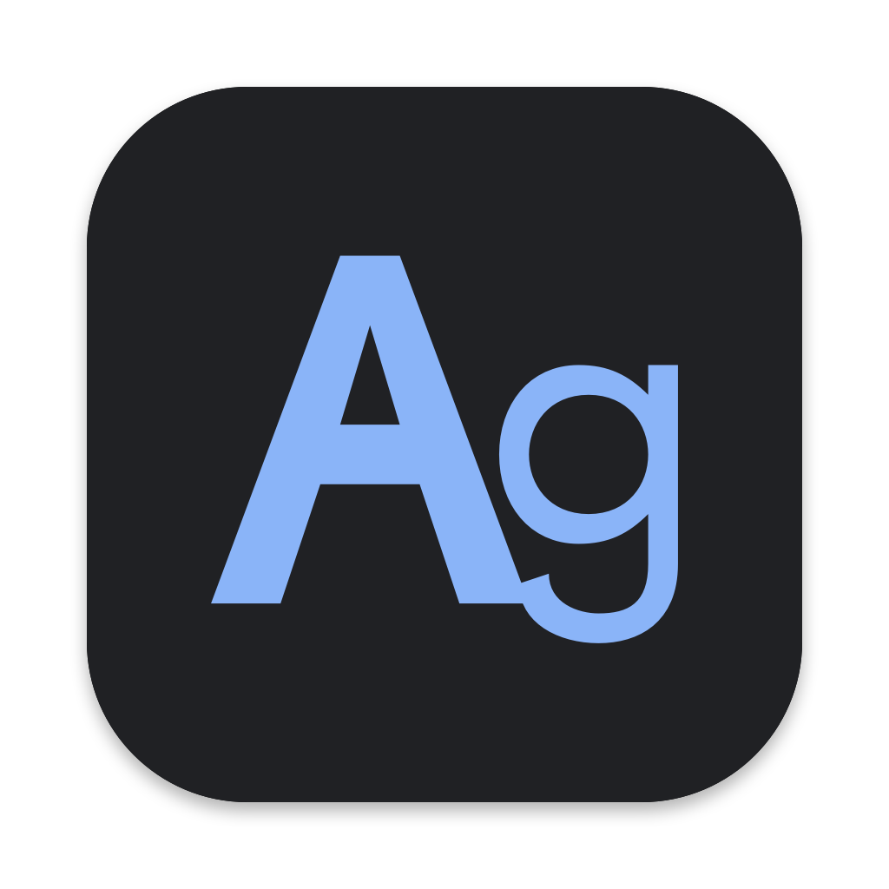
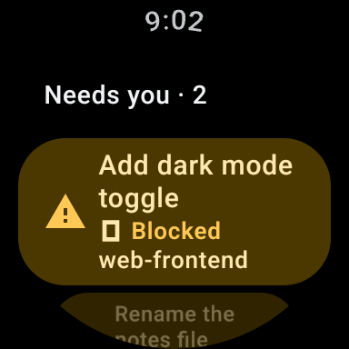
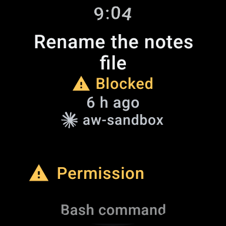
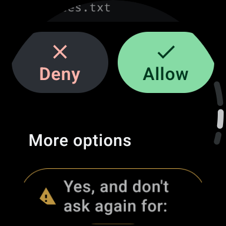
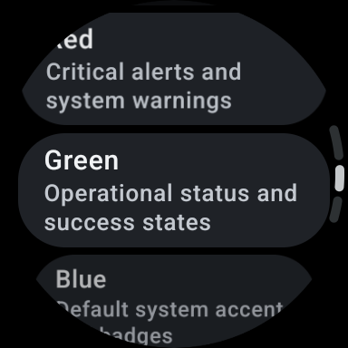

<p align="center">
  
</p>

# Agent Watch

Answer your coding agents from your wrist, phone, or menu bar. When Claude Code, OpenCode, Antigravity or another terminal agent asks for permission, asks a question or finishes a task, Agent Watch delivers the prompt and let you answer: Allow, Deny, the agent's custom choices, or a dictated/typed reply.

> **In daily use** on a Google Pixel Watch 2, Android phone, and macOS. What works, what is open and what comes next: [`docs/STATUS.md`](docs/STATUS.md).

<p align="center">
  
  
  
  
</p>
<p align="center"><sub>Wear OS app, sample agents in a sandbox workspace.</sub></p>

---

## How It Works

```
┌─────────────────────────────────────────┐          ┌───────────────────────┐          ┌──────────────────────────────────┐
│ Host (Mac or Linux)                     │          │ Cloud Relay (VPS)     │          │ Client Devices                   │
│                                         │          │                       │          │                                  │
│ coding agents (claude, opencode, agy...)│          │ agent-watch-relay     │          │ ┌──────────────────────────────┐ │
│   │                                     │          │   (state aggregation, │          │ │ Android Client Suite         │ │
│   ▼ (OSC 7501 status reports)           │   WSS    │    history store,     │  HTTPS   │ │                              │ │
│ herdr-core (hc)                         │ ═══════▶ │    FCM push, auth)    │ ═══════▶ │ │   ┌──────────────────────┐   │ │
│   │                                     │          └───────────────────────┘   SSE    │ │   │ shared :core layer   │   │ │
│   ▼ (local Unix domain socket)          │                                             │ │   └──────────┬───────────┘   │ │
│ agent-watch-bridge                      │                                             │ │        ┌─────┴─────┐         │ │
│   ▲                                     │                                             │ │        ▼           ▼         │ │
│   │ (embedded helper / CLI)             │                                             │ │   Wear OS (:app) Phone (:mobile)│
│ Agent Watch.app (macOS Menu Bar)        │                                             │ └──────────────────────────────┘ │
└─────────────────────────────────────────┘                                             └──────────────────────────────────┘
```

- **[herdr-core](https://herdr.dev)** (`hc` / Herdr app) runs your terminal agents and manages their lifecycles over a local Unix domain socket.
- **The bridge** (`agent-watch-bridge`) runs on your host machine and connects outbound via TLS WebSocket: no open inbound ports, no VPN required.
- **macOS Menu Bar** (`Agent Watch.app`) is a self-contained companion with an embedded universal bridge helper, live status, presence toggles (*Only Notify When Away*), and pairing actions.
- **The relay** (`agent-watch-relay`) is a single static Go binary hosted on your VPS that securely aggregates state across multiple machines, retains history, and sends FCM push notifications.
- **Android client suite (`android/`)**: Built on a unified Kotlin architecture where the shared **`:core`** module handles network sync, local caching, push parsing, and OTA updates for two specialized client surfaces:
  - **Wear OS (`:app`)**: Wrist-first glanceable status, one-tap approvals, quick dictation, tiles, and watch face complications.
  - **Android Phone (`:mobile`)**: Conversational chat interface, complete history inspection, grouped notifications with inline actions, and remote session launching across hosts.
- **Safety first:** Devices never send raw keystrokes. They send high-level intent (*"answer option X"*, *"cancel"*, *"prompt Y"*), and the bridge re-reads and fingerprints the terminal screen before pressing keys.

---

## What You Need

- **herdr-core** (`hc`) or **Herdr.app** and **Go** on the computer that runs your agents.
- A small **Linux VPS** with a domain and a TLS reverse proxy for the relay.
- An **Android device**: Wear OS smartwatch (tested on Pixel Watch 2) and/or Android phone, plus JDK 17, the Android SDK, and a **Firebase** project for push notifications.

Minimum versions and details: [Requirements](docs/GUIDE.md#requirements).

---

## Quick Start

1. **Configure:** Run `make config`, then set your relay domain and SSH target in `agent-watch.env`. It is the single, git-ignored deployment config.
2. **Deploy Relay:** Prepare the VPS once ([guide](docs/GUIDE.md#1-deploy-the-cloud-relay)), then run:
   ```bash
   make deploy-relay ARGS=--sync-env
   ```
3. **Run the Bridge:**
   - **macOS App (recommended):** Run `make app && open "bin/Agent Watch.app"`, or download the DMG/ZIP from [Releases](https://github.com/gabrielmarcano/agent-watch/releases).
   - **CLI / Linux Service:**
     ```bash
     make bridge && make configure-bridge
     ./bin/agent-watch-bridge start
     ```
4. **Install Android Apps:** Add your `google-services.json` in `android/app/` (watch) and/or `android/mobile/` (phone), then install:
   ```bash
   cd android
   ./gradlew :app:installDebug     # Wear OS watch (over wireless adb)
   ./gradlew :mobile:installDebug  # Android phone (over USB)
   ```
5. **Pair Your Device:** Run `./bin/agent-watch-bridge pair` (or press `⌘P` in the macOS menu bar app) and enter the code on your watch or phone.

Every step in detail, day-to-day commands, and troubleshooting are in **[the full guide](docs/GUIDE.md)**.

---

## Supported Agents

| Agent | Support | Capabilities |
|---|---|---|
| **Claude Code** (`claude`) | First-class | Permissions, plan approval, questions, background agent counts, transcript history |
| **OpenCode** (`opencode`) | First-class | Permissions, questions, SQLite database history |
| **Antigravity CLI** (`agy`) | First-class | Permissions, transcript history |
| **Any other agent** | Generic | Numbered menus, screen-capture fallback history |

Details: [`docs/reference/agents.md`](docs/reference/agents.md).

---

## Documentation

- **[Full Guide](docs/GUIDE.md):** Setup, daily operations, OTA updates, security model, and troubleshooting.
- **[Status & Roadmap](docs/STATUS.md):** Current phase status, deployed versions, and roadmap.
- **[Contracts](docs/reference/contracts.md):** JSON wire shapes, API endpoints, push payloads, and configuration keys.
- **[Contributing](AGENTS.md):** Architecture map, safety directives, and coding guidelines for human developers and AI agents.

---

## Support

If Agent Watch saves you trips to the keyboard, you can [buy me a coffee on Ko-fi](https://ko-fi.com/gabrielmarcano120). Bug reports and ideas are welcome as [GitHub issues](https://github.com/gabrielmarcano/agent-watch/issues).

---

## License

Copyright 2026 Gabriel Marcano. Licensed under the [Apache License, Version 2.0](LICENSE); see also [`NOTICE`](NOTICE).
